# nmrs-gui

A NetworkManager client for Linux, built on [nmrs](https://github.com/freedesktop-rs/nmrs) and [gpui](https://gpui.rs).

[](https://github.com/networkmanager-rs/nmrs-gui/actions/workflows/ci.yml)
[](https://crates.io/crates/nmrs-gui)

<p align="center">
  <picture>
    <source media="(prefers-color-scheme: dark)" srcset="assets/readme/dark-wifi.png">
    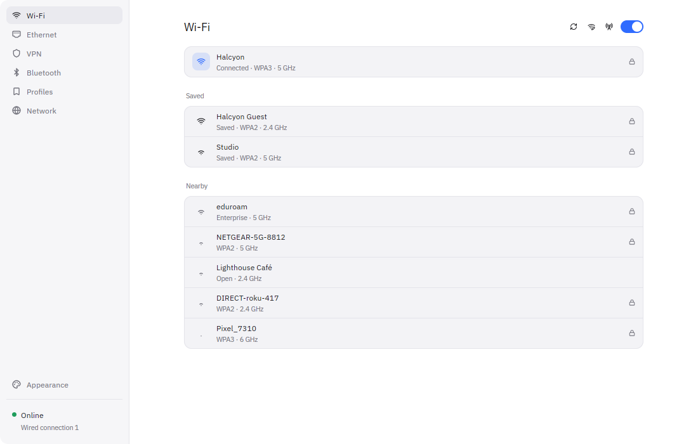
  </picture>
</p>

<table>
  <tr>
    <td width="50%">
      <picture>
        <source media="(prefers-color-scheme: dark)" srcset="assets/readme/dark-profiles.png">
        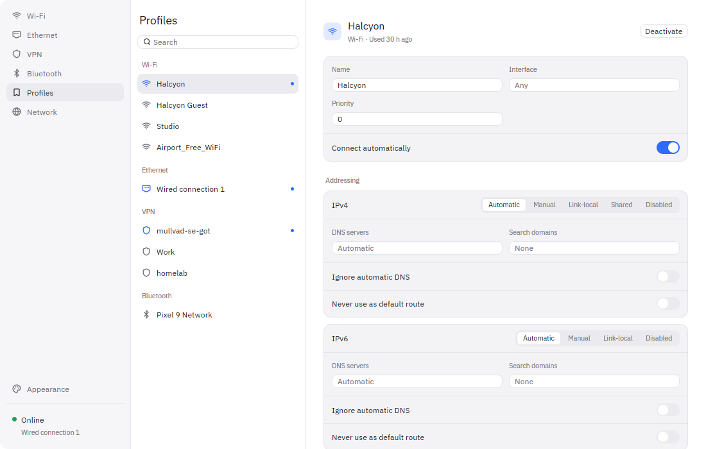
      </picture>
    </td>
    <td width="50%">
      <picture>
        <source media="(prefers-color-scheme: dark)" srcset="assets/readme/dark-network.png">
        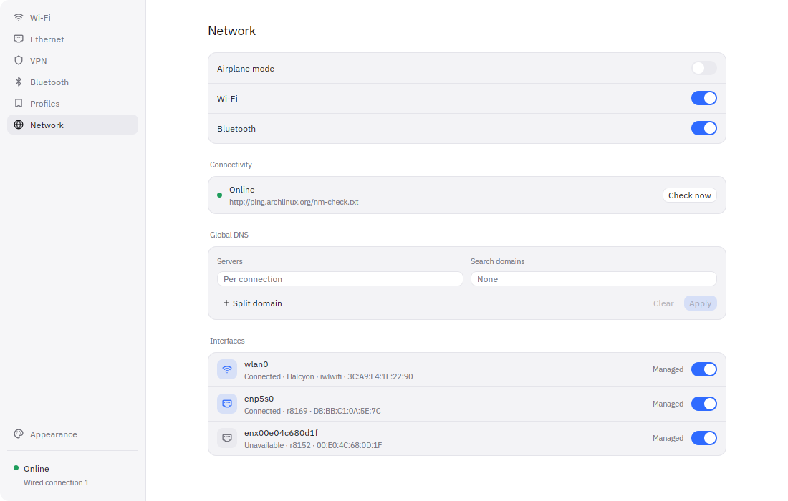
      </picture>
    </td>
  </tr>
  <tr>
    <td align="center"><sub>Profiles</sub></td>
    <td align="center"><sub>Network</sub></td>
  </tr>
  <tr>
    <td width="50%">
      <picture>
        <source media="(prefers-color-scheme: dark)" srcset="assets/readme/dark-vpn.png">
        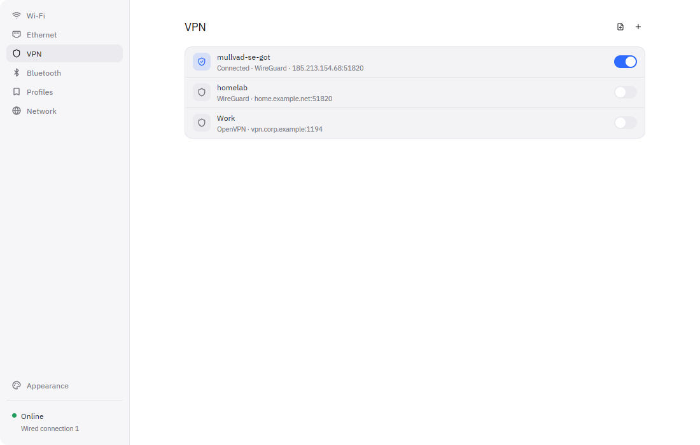
      </picture>
    </td>
    <td width="50%">
      <picture>
        <source media="(prefers-color-scheme: dark)" srcset="assets/readme/dark-appearance.png">
        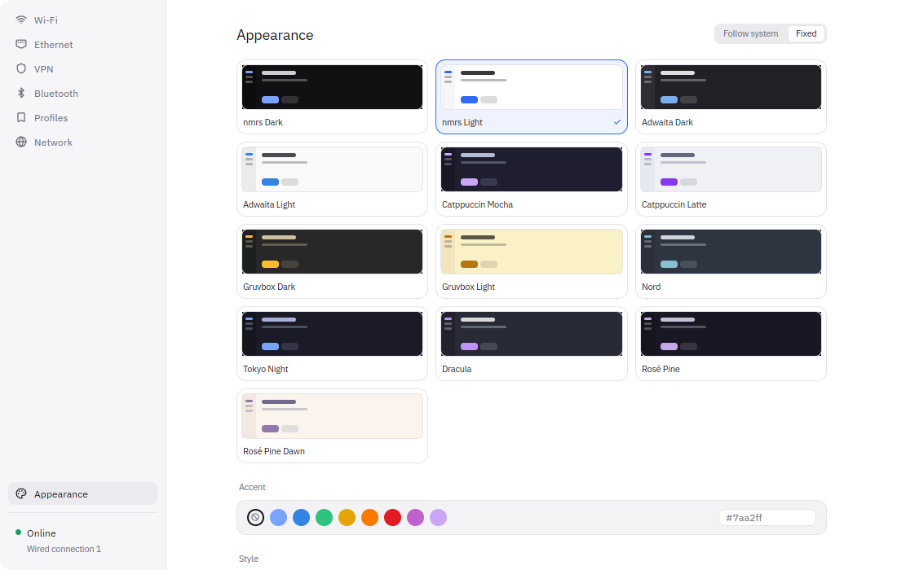
      </picture>
    </td>
  </tr>
  <tr>
    <td align="center"><sub>VPN</sub></td>
    <td align="center"><sub>Appearance</sub></td>
  </tr>
</table>

The compact layout, in a few of the built-in themes. Each one is a `config.toml` away; see [Configuration](#configuration).

<table>
  <tr>
    <td width="20%">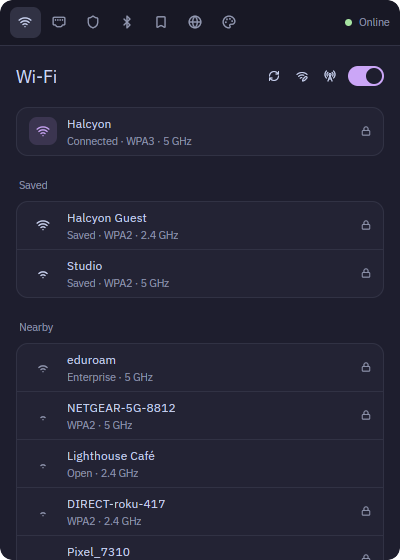</td>
    <td width="20%">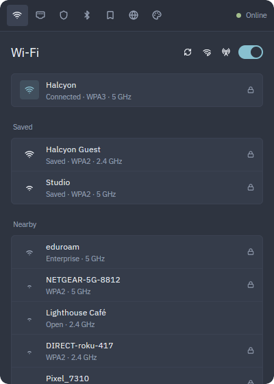</td>
    <td width="20%">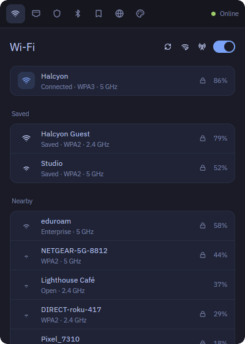</td>
    <td width="20%">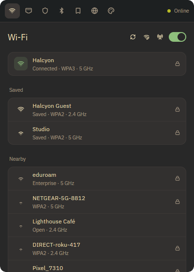</td>
    <td width="20%">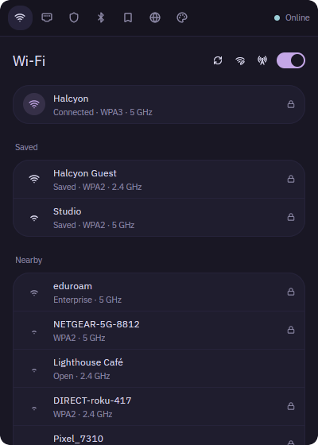</td>
  </tr>
  <tr>
    <td align="center"><sub>Catppuccin Mocha</sub></td>
    <td align="center"><sub>Nord · radius 4</sub></td>
    <td align="center"><sub>Tokyo Night · compact density</sub></td>
    <td align="center"><sub>Gruvbox Dark · custom accent</sub></td>
    <td align="center"><sub>Rosé Pine · radius 14</sub></td>
  </tr>
  <tr>
    <td width="20%">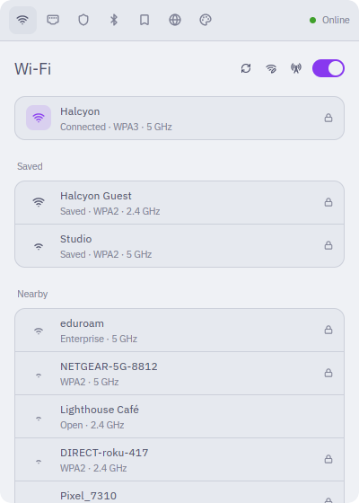</td>
    <td width="20%">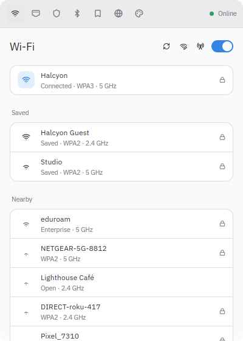</td>
    <td width="20%">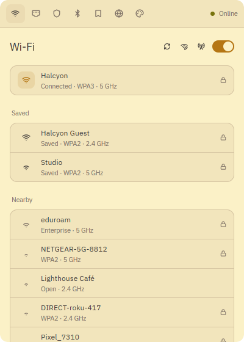</td>
    <td width="20%">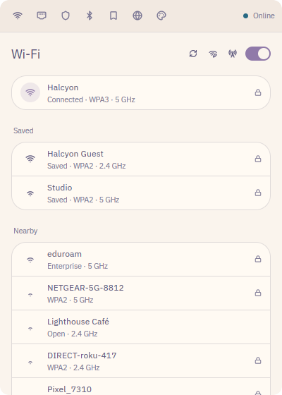</td>
    <td width="20%">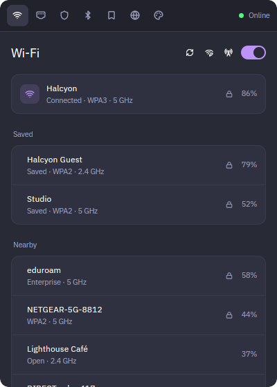</td>
  </tr>
  <tr>
    <td align="center"><sub>Catppuccin Latte</sub></td>
    <td align="center"><sub>Adwaita Light</sub></td>
    <td align="center"><sub>Gruvbox Light · custom accent</sub></td>
    <td align="center"><sub>Rosé Pine Dawn · radius 14</sub></td>
    <td align="center"><sub>Dracula · spacious density</sub></td>
  </tr>
</table>

## Features

- **Wi-Fi**: connect, disconnect and forget networks; WPA2, WPA3, Enhanced Open and Enterprise (PEAP, TTLS, TLS); pin a specific access point by BSSID; hidden networks; hotspot
- **Ethernet**: per-adapter status, link speed and addresses; managed and autoconnect toggles
- **VPN**: WireGuard and OpenVPN, `.ovpn` import, WireGuard setup with peers, per-tunnel autoconnect
- **Bluetooth**: PAN and DUN tethering
- **Profiles**: every saved connection with search, an IPv4/IPv6 editor (method, addresses, gateway, DNS, search domains, routing) and the full raw settings
- **Network**: airplane mode and radios, connectivity checks with captive portal sign-in, global DNS with split domains, interface management
- **Appearance**: built-in and user themes with live reload, accent color, font, density, radius, background opacity, sidebar or compact layout, page visibility

## Installation

### Arch Linux (AUR)

```bash
paru -S nmrs
```

### From crates.io

```bash
cargo install nmrs-gui
```

### From source

```bash
cargo install --path .
```

### Nix

```bash
nix run github:networkmanager-rs/nmrs-gui
```

## Usage

```
nmrs-gui [OPTIONS]

Options:
      --page <PAGE>      wifi, ethernet, vpn, bluetooth, profiles, network, appearance
      --layout <LAYOUT>  sidebar, compact
      --config <CONFIG>  Path to an alternative config file
      --app-id <APP_ID>  Wayland app id and instance name [default: nmrs]
      --demo             Run against sample data instead of NetworkManager
      --toggle           Show or hide the running window; with --page, switch to that page first
      --show             Show and raise the running window
      --hide             Hide the running window, keeping it ready
      --quit             Quit the running instance
      --status           Print network state as JSON and exit
      --watch            With --status, print a line on every change
  -V, --version          Print version and build hash
  -h, --help             Print help
```

One instance runs per app id. Launching `nmrs-gui` again raises the existing window; `--toggle`, `--show`, `--hide` and `--quit` control it. Use a separate `--app-id` to run, for example, a compact popup alongside the full window.

### Status

`nmrs-gui --status` prints one JSON object with connectivity, the primary connection, the active Wi-Fi network, wired links, VPNs, radios and the resolved theme colors; `--watch` keeps printing a line whenever something changes. Bars and widgets read it instead of polling `nmcli`.

A waybar module, for example:

```jsonc
"custom/nmrs": {
  "exec": "nmrs-gui --status --watch | jq --unbuffered -c '{text: (.primary.name // \"offline\"), tooltip: .connectivity, class: .connectivity}'",
  "return-type": "json",
  "on-click": "nmrs-gui --toggle --app-id nmrs-popup --layout compact"
}
```

### Keybindings

| Key                             | Action                                       |
| ------------------------------- | -------------------------------------------- |
| `Alt+1` … `Alt+7`               | Jump to page                                 |
| `Ctrl+Tab` / `Ctrl+Shift+Tab`   | Next / previous page                         |
| `Ctrl+R`, `F5`                  | Refresh (scans on the Wi-Fi page)            |
| `Tab` / `Shift+Tab`             | Move focus through the sidebar, list rows and controls |
| `↑` / `↓`                       | Previous / next row                          |
| `Enter`, `Space`                | Activate the focused row or button           |
| `Enter`                         | Connect from a password or network name field |
| `Esc`                           | Close the open form, or quit when none is open |
| `Ctrl+Q`                        | Quit                                         |

### Hyprland

```lua
hl.window_rule({
  match = { class = "^nmrs-popup$" },
  float = true,
  size = { 400, 560 },
})

hl.bind("SUPER + N", hl.dsp.exec_cmd("nmrs-gui --toggle --app-id nmrs-popup --layout compact"))
```

The Floating window toggle (Hyprland and Sway) floats the window over IPC after it opens. A window rule like the one above floats it before the first frame.

Set `appearance.opacity` below `1.0` to let the compositor's blur show through.

## Configuration

`~/.config/nmrs/config.toml` is created on the first change made in the app and reloaded whenever it changes on disk. Every key is optional.

```toml
[appearance]
theme = "system"           # a theme name, or "system" to follow the desktop
light_theme = "nmrs Light" # used when theme = "system"
dark_theme = "nmrs Dark"
accent = "#7aa2ff"         # omit to use the theme's accent
font_family = "Inter"
font_size = 14.0
radius = 8.0
opacity = 1.0
density = "comfortable"    # compact, comfortable, spacious

[layout]
mode = "sidebar"           # sidebar, compact
pages = ["wifi", "ethernet", "vpn", "bluetooth", "profiles", "network", "appearance"]
width = 920.0
height = 620.0
floating = true            # Hyprland and Sway; omit to leave it to the compositor

[wifi]
signal = "icon"            # icon, percent, both
show_band = true
show_bssid = false
show_security = true
min_strength = 0
sort = "signal"            # signal, name
scan_on_open = true

[devices]
show_virtual = false       # veth, bridge and tunnel interfaces

[behavior]
close_on_connect = false
close_on_escape = true
confirm_forget = true
```

`layout.pages` controls both which pages appear and their order.

## Themes

Built in: nmrs Light, nmrs Dark, Adwaita Light, Adwaita Dark, Catppuccin Latte, Catppuccin Mocha, Gruvbox Light, Gruvbox Dark, Nord, Tokyo Night, Dracula, Rosé Pine, Rosé Pine Dawn.

Add your own as JSON files in `~/.config/nmrs/themes/`. They appear in the Appearance page and reload on save. The format is the [gpui-component theme schema](https://github.com/longbridge/gpui-kit/raw/refs/heads/main/.theme-schema.json); a file can hold several themes and only the keys you set are overridden.

```json
{
  "name": "Mine",
  "themes": [
    {
      "name": "Midnight",
      "mode": "dark",
      "radius": 10,
      "colors": {
        "background": "#0b0d12",
        "foreground": "#e6e8ee",
        "border": "#1c2030",
        "muted.background": "#131722",
        "muted.foreground": "#7c859c",
        "accent.background": "#1a1f2e",
        "primary.background": "#5eead4",
        "primary.foreground": "#0b0d12",
        "secondary.background": "#131722",
        "sidebar.background": "#090b10",
        "sidebar.accent.background": "#1a1f2e",
        "danger.background": "#f87171",
        "success.background": "#4ade80",
        "warning.background": "#facc15"
      }
    }
  ]
}
```

A theme can also be pinned from the config:

```toml
[appearance]
theme = "Midnight"
```

## License

MIT, see [LICENSE-MIT](LICENSE-MIT).
